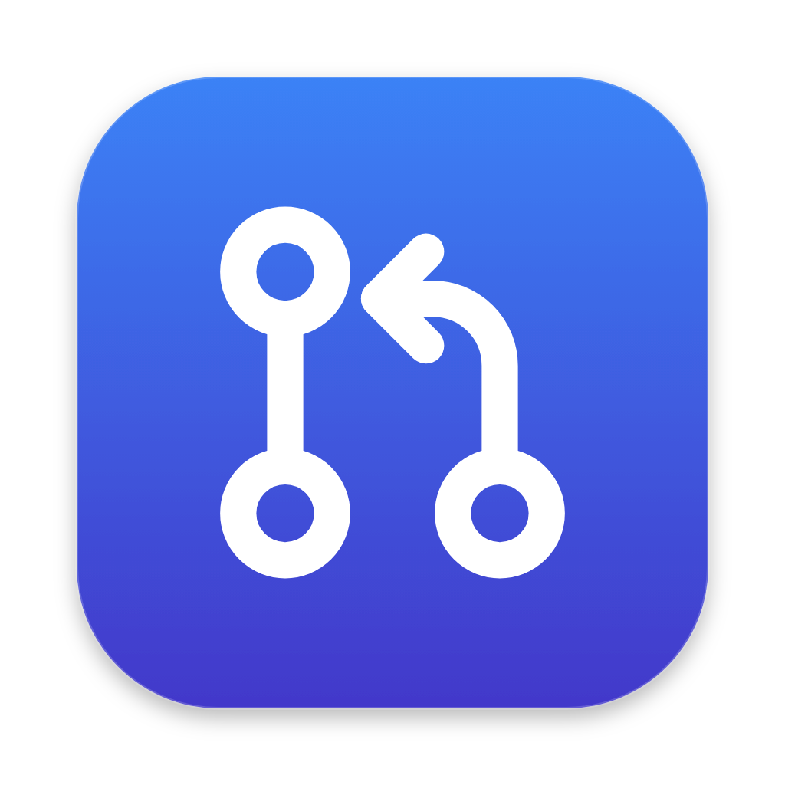

# PR Hub

PR Hub is a small macOS window that reviews a GitHub pull request against the task it was meant to do. You give it a task title, a PR link and a description. It runs the [`pr-review`](#requirements) Claude Code skill in the background and shows:

- a verdict: Approve, Approve with suggestions, or Request changes;
- a checklist of the task's requirements, each marked done, partial or missing;
- findings grouped by severity, each with its file and line and a suggested fix.

You can then post the findings you choose to the PR as a GitHub review. Nothing is posted until you've seen exactly what will be sent and confirmed it.



## Contents

- [Requirements](#requirements)
- [Install](#install)
- [Using PR Hub](#using-pr-hub)
- [How a review works](#how-a-review-works)
- [Security model](#security-model)
- [Where data is stored](#where-data-is-stored)
- [Development](#development)
- [Configuration](#configuration)
- [Project structure](#project-structure)
- [Troubleshooting](#troubleshooting)
- [Limitations](#limitations)

## Requirements

| Requirement                                                       | Why                                                                                                                                                                                                     | Check                                       |
| ----------------------------------------------------------------- | ------------------------------------------------------------------------------------------------------------------------------------------------------------------------------------------------------- | ------------------------------------------- |
| macOS on Apple Silicon                                            | The packaged build is arm64. Other platforms are untested (see [Limitations](#limitations)).                                                                                                            |                                             |
| [Claude Code](https://docs.claude.com/claude-code) CLI, signed in | Runs the review                                                                                                                                                                                         | `claude --version`                          |
| The `pr-review` skill                                             | Its instructions and its `scripts/fetch_pr.sh` drive the review. PR Hub looks for a `pr-review` folder containing `SKILL.md` anywhere under `~/.claude/skills`, including skills synced from claude.ai. | `ls ~/.claude/skills/**/pr-review/SKILL.md` |
| `git` and `python3`                                               | Used by the skill's fetch script                                                                                                                                                                        | `git --version`                             |
| [GitHub CLI](https://cli.github.com) (`gh`), signed in            | Needed only for **private repos** and **posting to GitHub**. Public PRs can be reviewed without it.                                                                                                     | `gh auth status`                            |

Each review is a full Claude Code session and is billed to your Claude account. Small PRs have cost about $0.10–$0.50 in testing. The app shows the cost of every review.

## Install

### From the DMG

1. Build it (see [Packaging](#packaging)) or get `pr-hub-<version>-arm64.dmg` from whoever built it.
2. Open the DMG and drag **PR Hub** to Applications.
3. The first time you open it, macOS may say it can't verify the developer, because the build is only ad-hoc signed. Right-click the app and choose **Open**, then **Open** again.
4. Optional: run `gh auth login` in a terminal to enable private repos and posting.

### From source

```bash
git clone <this repo> pr-hub && cd pr-hub
npm install
npm run dev
```

## Using PR Hub

### Review a PR

1. Fill in **Task title**, **PR link** (`https://github.com/<owner>/<repo>/pull/<n>`; `/files` and `#anchors` are fine) and **Task description**. Paste the ticket and acceptance criteria: the review is graded against this text.
2. Click **Review PR**, or press **⌘ Enter**.
3. Watch the progress list ("Fetching the PR", "Reading src/…"). Reviews usually take one to four minutes. You can hide the window; if it's hidden when the review finishes, you get a notification.
4. When it's done, there are two tabs:
   - **Findings:** the verdict, the requirement checklist, and findings grouped as Blocking, Should fix and Nits. Click a finding to expand or collapse it.
   - **Full review:** the complete written review.

The footer shows how long the review took and what it cost. If the reviewer tried something it isn't allowed to do, the footer also says how many tool calls were blocked; hover over it for details.

### Post findings to GitHub

1. Tick the findings to include. Blocking and should-fix findings are ticked by default; nits are opt-in.
2. Click **Post to GitHub…**.
3. The dialog shows exactly what will be posted:
   - the account,
   - the review summary,
   - each inline comment with its `file:line`,
   - which findings go in the summary instead of on a line, and why.
4. Choose **Comment** or **Request changes**, then click **Post**.

Posted findings get a **Posted** badge, which is still there when you reopen the review later.

How findings are placed:

- **Inline comments only go on lines the PR changed.** GitHub rejects a review if any comment points elsewhere, so other findings go in the summary.
- **Comments are pinned to the commit that was reviewed.** If the PR has new commits since, everything goes in the summary rather than risk landing on the wrong lines. Re-run the review to get inline comments back.
- **One-line code fixes become one-click GitHub suggestions,** and the preview labels them. Longer fixes are posted as plain code blocks, because GitHub would apply them to a single line.

### History

The form lists recent reviews with their verdict. Click one to reopen it read-only. **Re-run** reviews the PR again with the same task, and **←** returns to the form with that task filled in. The last 50 finished reviews are kept.

### Window and shortcuts

| Action                        | How                                                    |
| ----------------------------- | ------------------------------------------------------ |
| Show or hide the window       | Click the menu-bar icon                                |
| New review, Keep on Top, Quit | Right-click the menu-bar icon                          |
| Keep the window above others  | Pin button in the header (remembered between launches) |
| Submit the form               | ⌘ Enter                                                |
| New review (clears the form)  | ⌘ N                                                    |
| Back / close the post dialog  | Esc                                                    |
| Switch Findings / Full review | ← → when a tab is focused                              |

Closing the window hides it; a running review keeps going. Quit from the menu-bar menu or with ⌘ Q, which stops any running review first.

## How a review works

````
Form ──IPC──▶ main process
               1. bash <skill>/scripts/fetch_pr.sh <validated URL> <work dir>/pr
               2. claude -p (stream-json) with the skill as system prompt
                    reads pr.diff, files.txt, commits.txt and the checkout in <work dir>
               3. parse events → progress in the window
               4. extract the final ```json findings block, validate it (zod)
               5. save to history, delete the PR checkout
Window ◀── review:event ──┘
````

- **The app fetches the PR itself,** using the skill's fetch script. It passes the validated PR URL and a fixed destination as an argument list (no shell), so paths with spaces are safe and the model never picks arguments. If the fetch fails (private repo without `gh auth login`, wrong link, no network), the review stops before any model cost.
- **Skill loading:** headless `claude -p` doesn't load claude.ai-synced skills. So the app reads `SKILL.md`, fills in its folder path, and passes it with `--append-system-prompt`.
- **Structured output:** the prompt asks the reviewer to end with a JSON block: verdict, summary, requirements, and findings with `id`, `severity`, `file`, `line`, `body` and `suggestion`. If that block is missing or invalid, the app shows the written review with a notice and never crashes.
- **Cancel and timeout:** both cover the fetch and the review, and kill each process group (`claude` plus anything it started). The timeout is 15 minutes.

[PLAN.md](PLAN.md) has the full design, the IPC contract and the reasoning behind each choice. [PROMPTS.md](PROMPTS.md) has the step-by-step build prompts the app was developed from.

## Security model

The reviewer reads **untrusted input**: the PR's code, description and commit messages. The design assumes a PR may try to steer it.

**What the reviewer can do**

```
claude -p --tools "Read Grep Glob Bash" --permission-mode dontAsk   (no allow rules)
```

- `--tools` limits the reviewer to four tools. `dontAsk` refuses anything that would need approval, since nobody is there to answer.
- With no allow rules, file reads only work inside that review's own folder. An explicit `Read` rule would extend reads to the whole disk, which was verified.
- It can't edit files, run `git` or `gh`, use the network, or run the fetch script with its own arguments. (`git log/diff/show --output=<file>` can write files, which is why git isn't allowed.)
- The task text is sent over standard input, so it doesn't appear in process listings.

**What gets posted to GitHub**

- Two steps. The preview builds the exact payload and the main process keeps it. Post sends only that stored preview, once. The window never supplies the payload itself.
- Outside code, `@mentions` are disabled (so text from the PR can't ping people from your account), and `<` is escaped. That stops raw HTML, such as a hidden `<!-- … -->` comment, from carrying text the preview didn't show.
- A suggestion that reads like an instruction, not code, is never posted as a one-click suggestion.

**The app itself**

- The window runs sandboxed: `contextIsolation`, no Node access, `sandbox: true`. The preload exposes only the typed `window.api`.
- Every IPC handler checks that the call comes from the app's own page. The window can't navigate to another site (links open in your browser), and only one copy of the app runs at a time.
- GitHub access goes through your own `gh` login. PR Hub never sees or stores a token.

## Where data is stored

Everything lives in `~/Library/Application Support/PR Hub/`:

| Path                        | Contents                                                                                              |
| --------------------------- | ----------------------------------------------------------------------------------------------------- |
| `history.json`              | The last 50 finished reviews: task, written review, findings, cost, reviewed commit, and post records |
| `reviews/<id>/stream.jsonl` | The raw Claude Code event stream, for debugging. Deleted when the review drops out of history.        |
| `reviews/<id>/pr/`          | The PR checkout, only while a review is running. Deleted when it ends.                                |
| `settings.json`             | Keep-on-top setting                                                                                   |
| `window-state.json`         | Window size and position                                                                              |

To clear everything, quit the app and delete that folder.

## Development

```bash
npm install
npm run dev          # app with hot reload (renderer) and restart (main)
npm test             # unit tests (Vitest), ~95 tests
npm run test:watch
npm run lint
npm run typecheck
npm run build        # typecheck + production bundle in out/
npm run format       # prettier
```

### Working on the review screen without paying for reviews

In development builds the form has **Dev · replay fixture** links: _full_, _no findings_ and _error_. They replay [fixtures/sample-stream.jsonl](fixtures/sample-stream.jsonl), a real recorded review, through the same parser as a live run. Replays aren't saved to history and can't be posted. The links and the replay handler don't exist in packaged builds.

### Running a review from the terminal

```bash
npm run review:cli -- https://github.com/owner/repo/pull/123 "Task title" "Task description" [work-dir]
PR_HUB_MODEL=haiku npm run review:cli -- …   # cheaper, for testing
```

This uses the same runner as the app (no Electron). It prints progress to stderr and the result as JSON to stdout, and saves the raw stream to `<work-dir>/stream.jsonl`.

### Testing GitHub posting without posting

Point `PR_HUB_GH` at a stand-in script that answers `gh auth status` / `gh api …` from fixtures and saves POST bodies to a file instead of sending them. The real responses for one PR are in [fixtures/github/](fixtures/github/). Combine it with `PR_HUB_USER_DATA` so test data stays out of your real history:

```bash
PR_HUB_USER_DATA=/tmp/prhub-test PR_HUB_GH=/path/to/fake-gh npm run dev
```

### Icons

The app icon and menu-bar icon are drawn from SVG sources in [resources/icons/](resources/icons/). After editing them:

```bash
npm run icons   # renders PNGs with Electron, builds build/icon.icns with iconutil
```

### Packaging

```bash
npm run build:mac   # → dist/pr-hub-<version>-arm64.dmg
```

The DMG is **ad-hoc signed**: enough to run on Apple Silicon, but Gatekeeper will warn on first open. To distribute it, set a Developer ID `identity` in [electron-builder.yml](electron-builder.yml), enable `hardenedRuntime` and `notarize`, and build again.

## Configuration

These environment variables are mainly for development and testing:

| Variable           | Effect                                                                        |
| ------------------ | ----------------------------------------------------------------------------- |
| `PR_HUB_MODEL`     | Model for reviews, e.g. `haiku`, `sonnet` (default: your Claude Code default) |
| `PR_HUB_SKILL_DIR` | Use this `pr-review` skill folder instead of searching `~/.claude/skills`     |
| `PR_HUB_USER_DATA` | Use another data folder (history, settings, reviews)                          |
| `PR_HUB_GH`        | Path to the `gh` binary to use (e.g. a test stand-in)                         |

The app finds `claude` and `gh` on your **login shell's PATH**. Apps opened from Finder get a minimal PATH, so the app asks your shell for the full one. If you can run `claude` in a new terminal window, PR Hub can find it.

## Project structure

```
src/
  main/                     Electron main process (Node)
    index.ts                window, menu-bar icon, notifications, single instance, quit handling
    reviewRunner.ts         fetch + `claude -p` lifecycle: cancel, timeout, process groups
    prompt.ts               system prompt (skill) and review prompt with the findings contract
    streamParser.ts         stream-json lines → progress events and the final result
    extractFindings.ts      pulls and validates the findings JSON block
    environment.ts          login-shell PATH, finding claude, finding the skill
    reviewIpc.ts            review and history IPC, saving finished reviews, folder cleanup
    historyStore.ts         history.json: crash-safe writes, queued updates, last 50
    githubReview.ts         findings → GitHub review payload (diff lines, suggestions, sanitizing)
    githubPoster.ts         gh CLI: auth check, PR files and head, submit
    githubIpc.ts            preview/post IPC (stored previews, posted once)
    ipcGuard.ts             rejects IPC calls from anything but the app's page
    settings.ts tray.ts windowState.ts bounds.ts replay.ts
  preload/index.ts          the typed window.api bridge
  renderer/src/             React UI
    App.tsx                 form ↔ review view, shortcuts
    components/             ReviewForm, ReviewView, FindingsPanel, PostDialog, RecentReviews, …
    review/                 reducer (state.ts), useReview hook, formatting helpers
  shared/                   types and pure code used by both sides
    ipc.ts                  IPC channels and API types (source of truth)
    findings.ts history.ts github.ts validate.ts markdown.ts
scripts/                    review-cli.ts, render-icons.mjs
fixtures/                   recorded review stream, GitHub API responses
```

Tests sit next to the code as `*.test.ts`.

## Troubleshooting

**"Claude Code CLI not found"**
Install Claude Code and check that `claude --version` works in a **new** terminal window. PR Hub reads the PATH from your login shell (`$SHELL -ilc`).

**"pr-review skill not found"**
Make sure the skill exists under `~/.claude/skills` (any depth, as a folder named `pr-review` containing `SKILL.md`), or set `PR_HUB_SKILL_DIR`.

**"Couldn't fetch the PR"**
The repo is probably private: run `gh auth login`. Otherwise, check the link and your network. The error includes the fetch script's output.

**"GitHub CLI is not logged in"** when posting
Run `gh auth login`, then click **Try again** in the dialog.

**GitHub rejects "Request changes"**
GitHub doesn't let you request changes on your own PR. Post as **Comment** instead.

**"N tool call(s) blocked"** in the footer
The reviewer tried something outside its sandbox, such as reading a file outside the review folder. That's expected now and then, and the review continues without it. Hover over the message to see what was blocked.

**`npm run dev` crashes with `Cannot read properties of undefined (reading 'isPackaged')`**
`ELECTRON_RUN_AS_NODE=1` is set in your environment. Some editor-integrated terminals and tools set it. Run `env -u ELECTRON_RUN_AS_NODE npm run dev`, or use a plain terminal.

**A review seems stuck**
Click **Cancel**. Reviews time out after 15 minutes anyway. The raw event stream is in `reviews/<id>/stream.jsonl` in the data folder.

## Limitations

- **macOS only, so far.** Cancelling relies on Unix process groups, and the build config, icons and login-shell PATH lookup assume macOS. `build:win` and `build:linux` scripts exist but are untested.
- **GitHub only.** The link must be a `github.com` PR.
- **One-line suggestions only.** Multi-line suggested fixes are posted as plain code, not one-click suggestions.
- **The skill is picked by date.** If several `pr-review` folders exist under `~/.claude/skills`, the most recently changed one is used; set `PR_HUB_SKILL_DIR` to pin one.
- **If the app crashes mid-review,** the `claude` process isn't stopped (quitting normally does stop it).
- **Edge case when posting:** if a post to GitHub times out _after_ GitHub accepted it, the app reports a failure. Check the PR before posting again.
